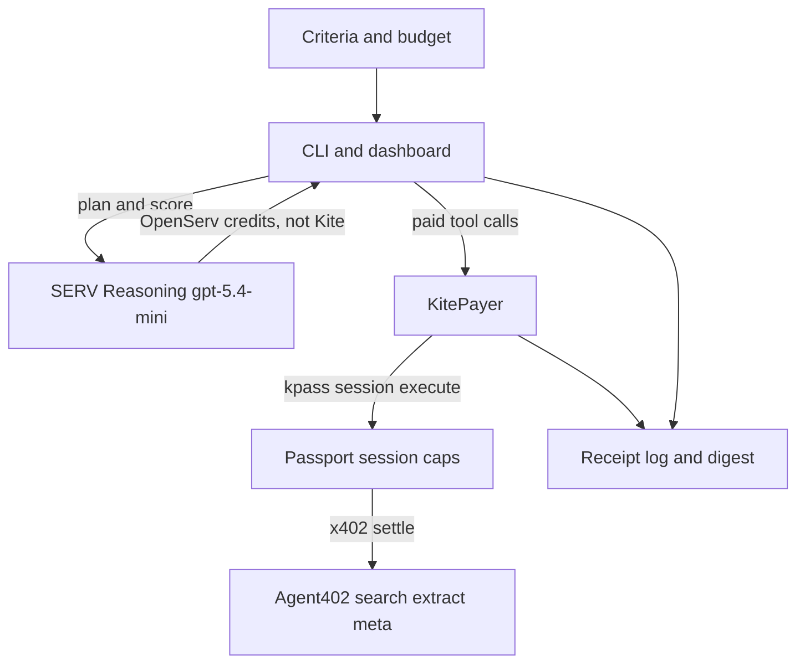

# Bounty Scout Agent

Bounty Scout finds crypto bounties, contests, and short paid gigs that fit a budget and a set of criteria (Solana first, free or gas-only entry, creative / contest / DeFi / gigs, under about 30 minutes). **SERV Reasoning** plans the research and scores each listing. **Kite Passport** pays for each [Agent402](https://agent402.tools) lookup inside a user-approved session. The result is a ranked digest plus a receipt for every call, including the calls the agent refused to make.

Built for [SERV Hackathon 02](https://www.openserv.ai/hackathon-2), **Kite track**. Every track has to use SERV Reasoning. This one also uses a verifiable Passport identity and a hard spending cap.

Dry-run is the default. Tests and `pnpm demo` use recorded fixtures and do not call the network. Live mode turns on only when `OPENSERV_API_KEY` (or `SERV_API_KEY`) is set **and** `kpass` is on `PATH`.

## Architecture



The loop is plan, act, enrich, score, render:

1. SERV sees the catalog, the remaining cap, and the criteria, then returns the searches worth paying for and the tools it rejects.
2. Before every paid call the process checks `list price + slack` against the remaining cap and the per-transaction cap. A refused call is written down and is not sent.
3. SERV picks which discovered URLs are worth a meta lookup and an extract. URLs that never appeared in search results are not fetched.
4. SERV scores effort, cost, reward, deadline, and legitimacy. The app recomputes the weighted overall score and drops anything with legitimacy under 4.
5. The CLI and the dashboard show the ranked digest and the receipt table.

## How SERV Reasoning is used

The client is the official `openai` package pointed at `https://inference-api.openserv.ai/v1` with `Authorization: Bearer` from `OPENSERV_API_KEY`, falling back to `SERV_API_KEY`. The default model is `gpt-5.4-mini` (`SERV_MODEL`) with `reasoning_effort: low`.

Three JSON calls, each with a required system prompt:

| Call | Job |
| --- | --- |
| `scout_plan` | Which searches to run, and which tools to reject, given prices and the remaining cap. |
| `scout_select` | Which result URLs are worth a paid `meta` or `extract`. |
| `scout_score` | Per-listing scores and a short rationale. |

Tool bodies are wrapped as untrusted data. Instructions inside a page or a snippet are not followed. SERV is billed to OpenServ credits. It is not paid through the Kite session.

If a model rejects `response_format: json_schema`, the client retries once with a JSON-only instruction and checks the body with zod.

## How Kite Passport is used

The supported payer is the `kpass` CLI (`KpassCliPayer`). A separate, passkey-approved session carries the demo limits: **$0.05 per transaction**, **$0.25 total**, **TTL 1 hour**, asset USDC. Paid calls are:

```bash
kpass session execute \
  --session-id "$KITE_SESSION_ID" \
  --url "<agent402 url>" \
  --method GET \
  --idempotency-key "<uuid>" \
  --output json --no-interactive --no-browser
```

Arguments are passed as an argv array. The merchant method is always set. Agent402 GET routes fail if the CLI's default POST is left in place. The idempotency key is a new UUID per payment.

The receipt uses `x402.status_code` as the merchant status, `payment_requirement.amount` as the amount actually paid, and `usage.spent_total` when Passport returns it. The local ledger is what the cap is enforced against, because a failed attempt still counts.

Spending stops on `session_total_exceeded`, `separate_session_used_up`, `insufficient_balance`, `wallet_empty`, `payment_cap_exceeded`, and `session_expired`. A `merchant_failed_held` result is recorded as failed and is not retried with a new key.

`PassportHttpPayer` (`KITE_PAYER=http`) is experimental. [Kite's API reference](https://docs.gokite.ai/api-reference) says agents should use the CLI and that there is no public HTTP API yet. Do not use it for the demo. Passport skills to read alongside this repo: [gokite-ai/passport-skills](https://github.com/gokite-ai/passport-skills) (`x402-execute`, `request-session`).

## Spending limits

Default budget is **$0.25**. Default slack is **$0.01**. Before a call is sent:

- if `listPrice + slack > remaining`, the call is `skipped_budget` and the payer is not invoked
- if `listPrice` is above the per-transaction cap (default $0.05), same refusal
- a failed or thrown attempt debits the receipt amount, or the list price when the receipt has no amount
- replays and budget skips debit nothing
- `/api/answer` ($0.08) is off unless `SCOUT_ALLOW_ANSWER=true`, and the $0.05 per-tx cap blocks it anyway

The $0.25 cap is for Agent402 only. Search caps default to 8 searches and 8 extracts. The whole run aborts spending after 8 minutes.

## Tool catalog

List prices from Agent402 on 11 Nov 2026. The ledger prefers the amount on the Kite receipt when one is present.

| Tool | Call | List price | Default |
| --- | --- | --- | --- |
| search-lite | `GET /api/search-lite` | $0.008 | yes |
| search | `GET /api/search` | $0.01 | yes |
| search-news | `GET /api/search-news` | $0.01 | yes |
| meta | `GET /api/meta` | $0.002 | yes |
| extract | `POST /api/extract` | $0.01 | yes |
| render | `POST /api/render` | $0.01 | only if extract is a thin JS shell |
| pdf | `POST /api/pdf` | $0.01 | when the URL is a PDF |
| answer | `GET /api/answer` | $0.08 | no |

A recorded dry-run spends **$0.076**: one search-lite, one search, one news search, four metas, four extracts. Answer is rejected by the planner. An upfront-SOL listing is not enriched and is dropped for legitimacy.

## Setup

- Node.js 22 or newer
- `pnpm install`
- Copy `.env.example` to `.env` only on your machine. `.env` is gitignored. Do not commit keys, Passport tokens, or `data/`.

Dry-run needs nothing else. Live mode also needs:

- An OpenServ key from [console.openserv.ai](https://console.openserv.ai/)
- [`kpass`](https://docs.gokite.ai/passport) 6.x on `PATH`, logged in
- A funded Passport wallet
- An approved spending session (`pnpm scout session create`)

## Dry-run

```bash
pnpm install
pnpm test
pnpm demo
pnpm scout run --dry-run --chains solana --budget 0.25 --entry free_or_gas --max-effort 30
pnpm scout digest
pnpm scout serve
```

Open [http://127.0.0.1:8787](http://127.0.0.1:8787). The dashboard binds to `127.0.0.1` so a live session is not exposed on the network. The page shows criteria, the cap, ranked cards, dropped listings, and the receipt table. `POST /api/run` starts a scout. `POST /api/stop` aborts further spend.

`pnpm demo` forces `SCOUT_MODE=dry-run`, unsets API keys, runs the CLI, and checks that the digest is ranked, the answer tool was skipped, and spend is inside the cap.

Set `SCOUT_DRY_RUN_DELAY_MS=200` if you want the receipt table to tick during a dry-run instead of appearing all at once.

## Live

```bash
cp .env.example .env
# set OPENSERV_API_KEY, leave SCOUT_MODE=auto or set SCOUT_MODE=live
pnpm scout session create
pnpm scout run --live --chains solana --budget 0.25 --entry free_or_gas --max-effort 30
pnpm scout serve --live
```

`session create` runs `kpass session create --separate` with the caps above, prints the approval URL, waits for the passkey approval, and writes the session id to `data/session.json` (gitignored). You can also set `KITE_SESSION_ID`. Without a session id, live `run` exits before any paid call.

Auto mode (`SCOUT_MODE` unset or `auto`) is live only when a SERV key is present and `kpass` is on `PATH`. Otherwise it stays on fixtures. `--dry-run` always wins.

## Tests

`pnpm test` uses node:test. It covers the cap math (including failed attempts), receipt parsing, secret redaction, catalog URLs, SERV request shape, `kpass` argv, the dry-run scout, and the dashboard API. Nothing in the suite calls OpenServ or Passport.

## Hackathon write-up

Bounty Scout is a research agent with a spending limit, not a search box. The user approves a Kite Passport session ($0.05 / $0.25 / 1 hour). SERV Reasoning (`gpt-5.4-mini` on the OpenServ inference API) decides which Agent402 calls are worth paying for and later scores each opportunity on effort, cost, reward, deadline, and legitimacy. The weighted overall is `0.20*effort + 0.15*cost + 0.25*reward + 0.15*deadline + 0.25*legitimacy`. Listings under legitimacy 4 are dropped. The agent never applies to a bounty and never sends funds to a listing.

The Kite-track piece is the audit trail: every paid call, every refusal, the list price, the amount actually charged, and the running total. When the session is exhausted or the next estimate would break the cap, spending stops and the digest still renders from what was already collected.

The longer submission note is in [WRITEUP.md](WRITEUP.md). A public demo video and an X post are still required before the form at [openserv.typeform.com/submissions02](https://openserv.typeform.com/submissions02). Deadline: 15 November 2026, 23:59 UTC.

## Disclaimer

Bounties can be scams. Scores are assistive. Reward figures labeled as estimates are model estimates, not quotes. Dry-run listings are fixtures shipped in `fixtures/dry-run/scout.json`, not a live crawl. This project does not custody funds and does not submit applications.
